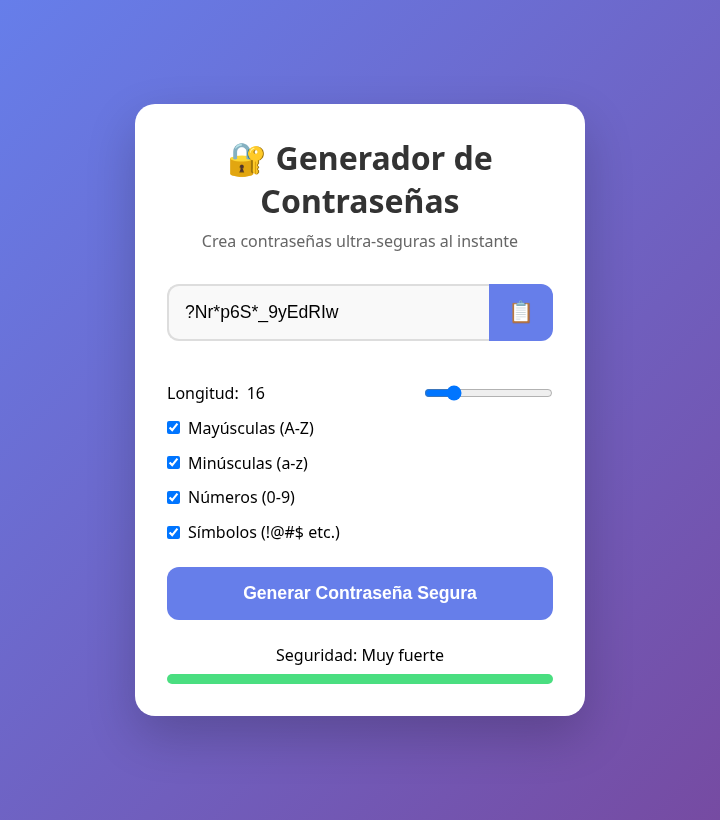

# Generador de contraseñas

Aplicación web para crear contraseñas seguras al instante, hecha con HTML, CSS y JavaScript puro (sin dependencias).

[](https://github.com/NickPro5677/Generador-de-contrase-as/actions/workflows/test.yml)
[](LICENSE)
[](https://nickpro5677.github.io/Generador-de-contrase-as/)

👉 **Pruébalo aquí:** https://nickpro5677.github.io/Generador-de-contrase-as/



## Funciones

- Longitud configurable de 8 a 50 caracteres (16 por defecto).
- Elección de los tipos de caracteres: mayúsculas, minúsculas, números y símbolos.
- **Garantiza al menos un carácter de cada tipo marcado** y luego mezcla todo al azar.
- Usa el generador criptográfico del navegador (`crypto.getRandomValues`), no `Math.random`.
- Indicador de fuerza (Débil, Media, Fuerte, Muy fuerte) según la longitud y los tipos elegidos.
- Botón para copiar, con aviso de éxito o de error.
- Accesible: botones con nombre para lectores de pantalla, avisos anunciados en voz alta y foco visible con el teclado.

## Cómo usarlo

**Desde el navegador:** abre la [demo en vivo](https://nickpro5677.github.io/Generador-de-contrase-as/). No hay que instalar nada.

**En una computadora:** descarga o clona el repositorio y abre `index.html` en el navegador. No hace falta servidor.

## Estructura del proyecto

| Archivo | Contenido |
|---|---|
| `index.html` | Estructura de la página |
| `style.css` | Estilos |
| `generador.js` | Lógica pura: crear la contraseña, mezclar y calcular la fuerza |
| `app.js` | Conecta la lógica con la pantalla: botones, casillas, barra y copiar |
| `tests/generador.test.js` | Pruebas automáticas de `generador.js` |
| `.github/workflows/test.yml` | CI: corre las pruebas en cada push y pull request |

## Pruebas

Las pruebas usan `node:test` (incluido en Node, sin dependencias):

```bash
npm test
```

GitHub Actions las corre solo en cada cambio.

## Qué aprendí

- **`Math.random` no sirve para contraseñas:** es predecible si se conocen sus valores anteriores. `crypto.getRandomValues` usa una fuente de azar pensada para seguridad.
- **Azar sin trampa:** usar `%` (módulo) directamente favorece a algunos caracteres; por eso `secureRandomIndex` descarta los valores del final del rango.
- **Probar en cantidad:** al generar 500 contraseñas descubrí que más de la mitad podía salir sin algún tipo marcado. Ahora se garantiza uno de cada tipo y se mezcla con el algoritmo de Fisher-Yates.
- **Separar lógica y pantalla** para poder probar el código con Node.
- **Código asíncrono:** copiar al portapapeles tarda; con `async/await` y `try/catch` se sabe si de verdad funcionó.
- **Accesibilidad:** `aria-label` y `aria-live` para que la página también sirva con lectores de pantalla.

## Licencia

Distribuido bajo la licencia MIT. Mira el archivo [LICENSE](LICENSE).
