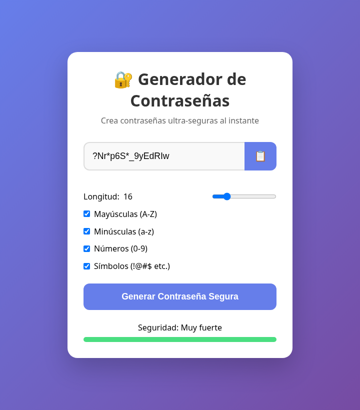

# Generador de contraseñas

Aplicación web para crear contraseñas al instante, hecha con HTML, CSS y JavaScript puro. Funciona con comodidad desde el teléfono.

[](https://github.com/NickPro5677/Generador-de-contrase-as/actions/workflows/test.yml)
[](LICENSE)

**Demo:** https://nickpro5677.github.io/Generador-de-contrase-as/



## Para qué sirve

Generar una contraseña en el navegador, eligiendo la longitud y los tipos de caracteres, y copiarla al portapapeles.

## Funciones

- Longitud configurable de 8 a 50 caracteres (16 por defecto).
- Elección de los tipos de caracteres: mayúsculas, minúsculas, números y símbolos.
- Garantiza al menos un carácter de cada tipo marcado y luego mezcla todo al azar.
- Usa el generador criptográfico del navegador (`crypto.getRandomValues`), no `Math.random`.
- Indicador de fuerza (Débil, Media, Fuerte, Muy fuerte) según la longitud y los tipos elegidos.
- Botón para copiar, con aviso de éxito o de error.
- Accesible: botones con nombre para lectores de pantalla, avisos anunciados en voz alta y foco visible con el teclado.

## Cómo usarlo

**Desde el teléfono:** abre la [demo](https://nickpro5677.github.io/Generador-de-contrase-as/). No hay que instalar nada.

**En una computadora:** descarga o clona el repositorio y abre `index.html` en el navegador. No hace falta servidor.

```sh
git clone https://github.com/NickPro5677/Generador-de-contrase-as.git
```

## Estructura de archivos

```text
Generador-de-contrase-as/
├── index.html                 # La página
├── style.css                  # Estilos
├── generador.js               # Lógica pura: crear, mezclar y medir la fuerza
├── app.js                     # Botones, casillas, barra y copiar
├── tests/generador.test.js    # Pruebas de generador.js
├── docs/                      # Captura
└── .github/workflows/         # CI
```

## Tecnologías

- HTML, CSS y JavaScript, sin dependencias
- `crypto.getRandomValues` del navegador
- `node --test` para las pruebas (6 casos en `tests/generador.test.js`)
- GitHub Pages

## Pruebas

```bash
npm test
```

GitHub Actions las corre en cada push y en cada pull request.

## Qué aprendí

- `Math.random` no sirve para contraseñas: es predecible si se conocen sus valores anteriores. `crypto.getRandomValues` usa una fuente de azar pensada para seguridad.
- Azar sin trampa: usar `%` (módulo) directamente favorece a algunos caracteres; por eso `secureRandomIndex` descarta los valores del final del rango.
- Probar en cantidad: al generar 500 contraseñas, más de la mitad podía salir sin algún tipo marcado. Ahora se garantiza uno de cada tipo y se mezcla con el algoritmo de Fisher-Yates.
- Separar lógica y pantalla para poder probar el código con Node.
- Código asíncrono: copiar al portapapeles tarda; con `async/await` y `try/catch` se sabe si de verdad funcionó.
- Accesibilidad: `aria-label` y `aria-live` para que la página también sirva con lectores de pantalla.

## Estado

Activo. No hay issues abiertos ni *releases* publicadas.

## Licencia

Distribuido bajo la licencia [MIT](LICENSE).
